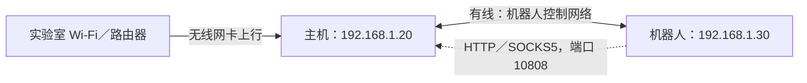

# 实验室机器人环境配置

本组教程完成四个任务：主机通过 Wi-Fi 上网并向机器人提供有线共享、机器人设置固定地址、机器人通过主机的 10808 应用代理上网，以及为需要访问 GitHub 的用户配置 SSH 密钥。

## 实验室默认参数

这里的“默认”指本组教程约定的参数。NetPilot 仍需手动填写网段、地址和连接名称；配置主机不会同时配置机器人。

| 参数 | 主机 | 客户端／机器人 |
|---|---|---|
| 有线连接名称 | `机器人控制网络` | `机器人控制网络` |
| 有线网段 | `192.168.1.0/24` | `192.168.1.0/24` |
| 有线 IPv4 地址 | `192.168.1.20/24` | `192.168.1.30/24` |
| 有线默认网关 | 不填写，主机使用现有上行 | `192.168.1.20` |
| 有线 DNS | 共享模式由 NetworkManager 提供 | `192.168.1.20` |
| 应用代理入口 | 在下行地址监听 `10808` | 连接 `192.168.1.20:10808` |

两台设备的连接名称各自在本机生效，可以相同。`.30` 用于一台机器人；增加机器人时分配不同地址。无线网卡和有线网卡的名称以软件检测结果为准。

## 按任务执行

| 顺序 | 教程 | 在哪台设备运行 NetPilot |
|---|---|---|
| 1 | [主机 Wi-Fi 上行与有线共享](01_主机WiFi上行与有线共享.md) | 主机 |
| 2 | [客户端设置静态 IP](02_客户端静态IP.md) | 客户端／机器人 |
| 3 | [客户端借用主机的 10808 代理](03_客户端借用主机10808代理.md) | 主机先准备代理服务，客户端配置 NetPilot |
| 4 | [配置并添加 GitHub SSH 密钥](04_GitHubSSH密钥.md) | 需要访问 GitHub 的主机或客户端，分别操作 |

前两项需要分别在两台设备完成。主机试运行期间可在客户端执行第二篇教程，验证两端后各自输入 `KEEP`。第三项使用已有代理服务；第四项需在 GitHub 网页保存公钥。

每台设备保留完整项目目录，在该目录打开终端。环境要求和启动方法见[开始使用](../01_开始使用.md)，问题排查见[诊断与故障处理](../07_诊断与故障处理.md)。
